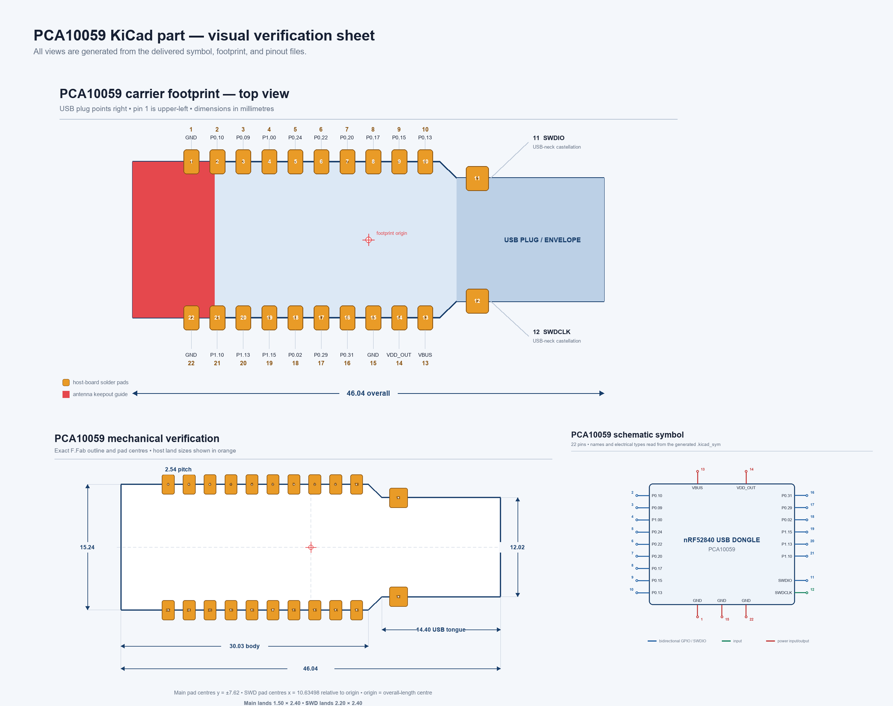

# PCA10059 nRF52840 USB Dongle — KiCad library

A simplified KiCad symbol and carrier-board footprint for using Nordic
Semiconductor's PCA10059 nRF52840 USB Dongle as a soldered castellated module.
It preserves the external pinout, physical outline, USB envelope, and antenna
keepout without reproducing the dongle's internal circuitry.



| | |
|---|---|
| Library version | `1.0.0` |
| Source files | KiCad 8 or newer |
| Online PCM repository | KiCad 10 or newer |
| External contacts | 22 |

## Install from the online repository

After this repository has been pushed to GitHub and GitHub Pages has deployed,
the KiCad repository URL is:

```text
https://binloan.github.io/nrf52840-dongle-kicad/repository.json
```

In KiCad 10 or newer:

1. Open **Plugin and Content Manager** from the KiCad Project Manager.
2. Select **Manage…** at the top of the Repository tab.
3. Add the full `repository.json` URL above.
4. Select the new repository, find **PCA10059 nRF52840 USB Dongle Library**,
   and install it.

KiCad automatically adds installed content libraries to the symbol and
footprint tables. The PCM archive is built for KiCad's default `PCM_` library
nickname prefix. If you have changed that prefix under **Preferences → Packages
and Updates → Library package handling**, reassign the symbol's footprint to
the installed footprint library nickname.

The repository uses KiCad's PCM v2 metadata because the retained Nordic licence
is represented accurately as `LicenseRef-Nordic-5-Clause`. For KiCad 8 or 9,
use the manual installation below.

## Install manually or from a Git clone

Clone the repository:

```sh
git clone https://github.com/binloan/nrf52840-dongle-kicad.git
```

Then add these libraries in KiCad:

- **Preferences → Manage Symbol Libraries**:
  `PCA10059_nRF52840_Dongle.kicad_sym`
- **Preferences → Manage Footprint Libraries**:
  `PCA10059_nRF52840_Dongle.pretty`

Use `PCA10059_nRF52840_Dongle` as the nickname for both. The checked-in symbol
already references
`PCA10059_nRF52840_Dongle:PCA10059_nRF52840_Dongle`.

For a project-local copy, place this repository in the project as
`PCA10059_KiCad_Library`; the supplied `sym-lib-table` and `fp-lib-table` can
then be merged into the project's existing tables.

## Publish this repository on GitHub

The folder is configured for `binloan/nrf52840-dongle-kicad`. During GitHub
Actions runs, the package builder also verifies the actual owner and repository
from `GITHUB_REPOSITORY`.

1. Create an empty public GitHub repository named
   `nrf52840-dongle-kicad` under the `binloan` account.
2. In the empty repository, open **Settings → Pages → Build and deployment**
   and select **GitHub Actions**. This one-time step must be completed before
   the Pages workflow can configure or deploy the site.
3. Push this folder's `main` branch to it.
4. If the first workflow started before Pages was enabled, re-run
   **Publish KiCad PCM repository** under **Actions**.
5. Open the deployed Pages URL. It shows the exact `repository.json` URL to
   add in KiCad.

Typical command-line publication after creating the empty GitHub repository:

```sh
git remote add origin https://github.com/binloan/nrf52840-dongle-kicad.git
git push -u origin main
```

Every push to `main` validates the part, builds a versioned ZIP package, creates
`packages.json` and `repository.json`, and deploys them through GitHub Pages.
For a public update, bump `VERSION` and add a `CHANGELOG.md` entry before
merging. Pull requests and non-main branches run the same validation without
publishing.

The packaging follows KiCad's official
[content-library layout](https://dev-docs.kicad.org/en/addons/index.html#content-libraries),
and the Pages workflow follows GitHub's official
[custom Pages workflow](https://docs.github.com/pages/getting-started-with-github-pages/using-custom-workflows-with-github-pages).

## Library contents

- `PCA10059_nRF52840_Dongle.kicad_sym` — 22-pin schematic symbol.
- `PCA10059_nRF52840_Dongle.pretty/PCA10059_nRF52840_Dongle.kicad_mod` —
  host-board land pattern, exact module outline, courtyard, and silkscreen.
- `pinout.csv` — machine-readable pin map.
- `visuals/` — generated footprint, mechanical, and symbol verification views.
- `render_visuals.py` — regenerates the verification images.
- `scripts/build_pcm.py` — validates the part and builds the online repository.
- `.github/workflows/` — validation and GitHub Pages publication.

## Orientation and pin numbering

View is from the top of the dongle, with the USB plug pointing right. Pin 1 is
marked at the upper-left. Pins run counter-clockwise around the module:

| Pin | Signal | Pin | Signal |
|---:|---|---:|---|
| 1 | GND | 22 | GND |
| 2 | P0.10 | 21 | P1.10 |
| 3 | P0.09 | 20 | P1.13 |
| 4 | P1.00 | 19 | P1.15 |
| 5 | P0.24 | 18 | P0.02 |
| 6 | P0.22 | 17 | P0.29 |
| 7 | P0.20 | 16 | P0.31 |
| 8 | P0.17 | 15 | GND |
| 9 | P0.15 | 14 | VDD_OUT |
| 10 | P0.13 | 13 | VBUS |
| 11 | SWDIO | 12 | SWDCLK |

Pins 11 and 12 are the two castellated contacts on the USB-neck edges.

## Mechanical definition

- Overall length: **46.04 mm**.
- Main body: **30.03 mm × 15.24 mm**.
- USB tongue after the shoulder: **14.40 mm × 12.02 mm**.
- Main castellations: **2.54 mm pitch**, centered on the `y = ±7.62 mm`
  board edges.
- Footprint origin: center of the 46.04 mm overall length and board centerline.
- Main host pads: **1.50 mm × 2.40 mm**.
- SWD host pads: **2.20 mm × 2.40 mm**.
- Courtyard: full module-and-host-pad envelope plus 0.25 mm.

The exact polygonal PCB outline is on `F.Fab`; a pad-safe outline and pin-1
marker are on `F.SilkS`.

## Important layout notes

- The leftmost 8 mm of the module contains the 2.4 GHz PCB antenna. The
  footprint marks this region on `Dwgs.User` as `ANTENNA / NO COPPER BELOW`.
  Keep copper, planes, traces, components, batteries, and enclosure metal away
  unless you validate RF performance yourself.
- The USB tongue normally needs to project beyond the carrier-board edge. Use
  the exact `F.Fab` outline when positioning it.
- `VBUS` is the USB 5 V rail. `VDD_OUT` is the dongle's regulated output; do
  not short these together.
- Connect all three GND pins to the carrier ground.
- The underside USB `D+`, `D-`, `VBUS2`, and `UGND` test pads are intentionally
  omitted because they are not castellated module contacts.
- No 3D model is included. Check component height and enclosure clearance
  against the physical dongle.

## Source and verification

Geometry and connectivity were cross-checked against the supplied Nordic
revision 2.1.1 files:

- `400250.GM1` board-outline Gerber.
- `400250-RoundHoles.TXT` and `400250-RectHoles.TXT` drill files.
- `400250_Pick_And_Place.csv` component coordinates.
- `PCA10059_Schematic_And_PCB.pdf` schematic, PCB plots, assembly view, and
  dimension drawing.

`scripts/build_pcm.py` independently verifies that the CSV, symbol, and
footprint all contain matching pins/pads 1–22 before publication.

## Licence and attribution

The original source package is Copyright © 2010–2021 Nordic Semiconductor ASA.
The derived library is distributed under the retained terms in `LICENSE.txt`,
including the requirement that it be used only with a Nordic Semiconductor
integrated circuit. Nordic Semiconductor does not endorse this repository.

